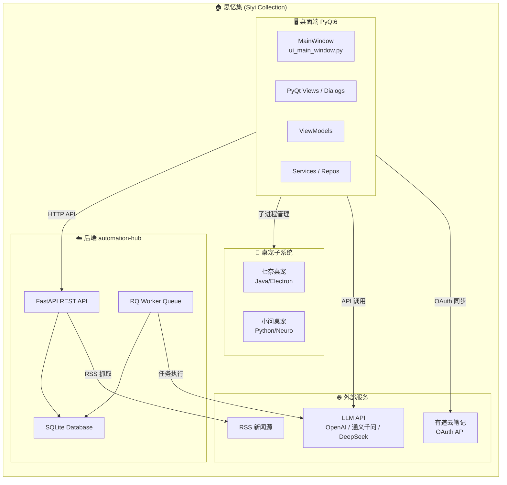
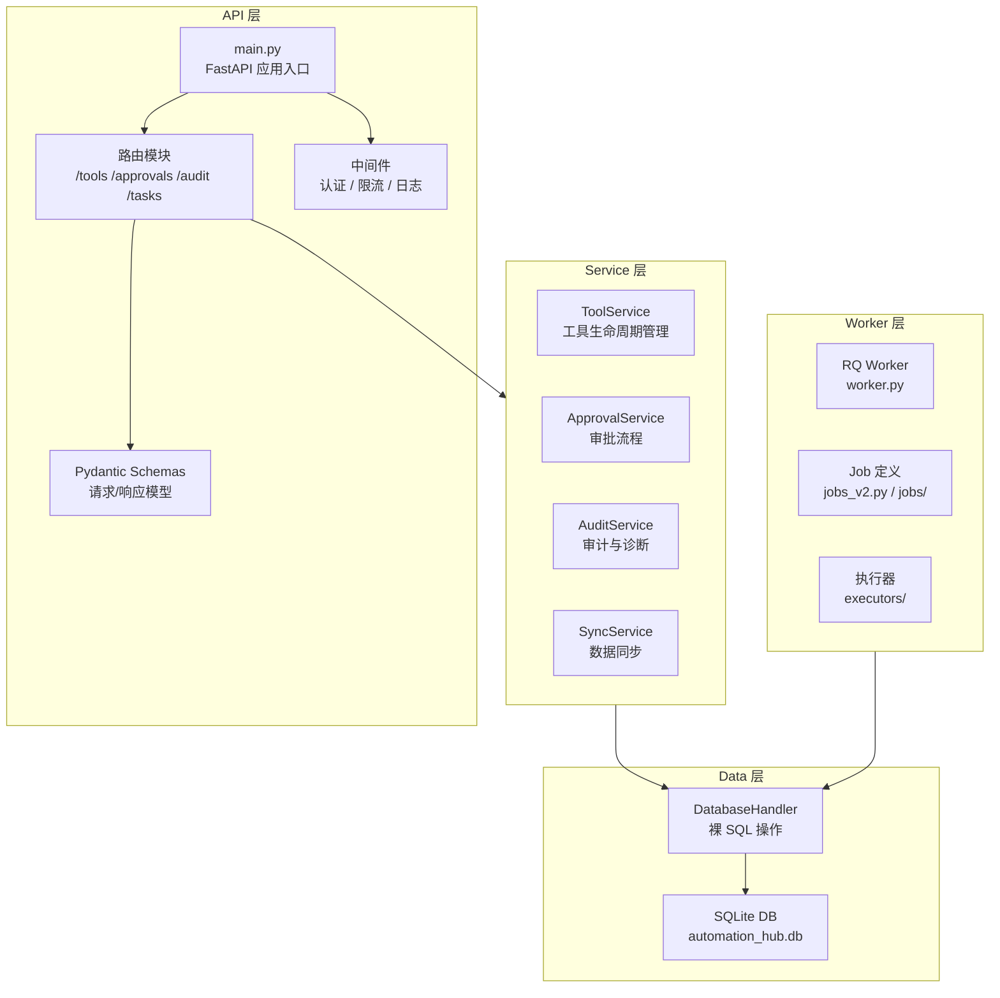
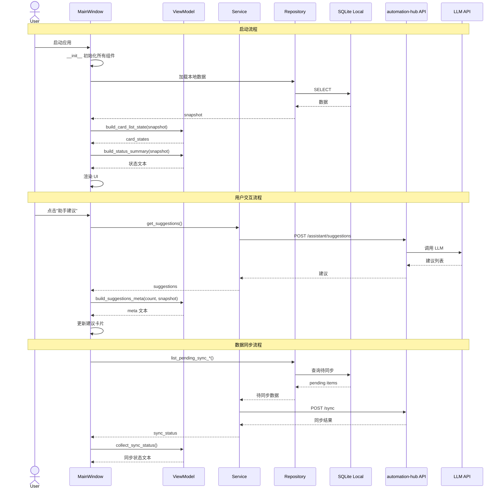
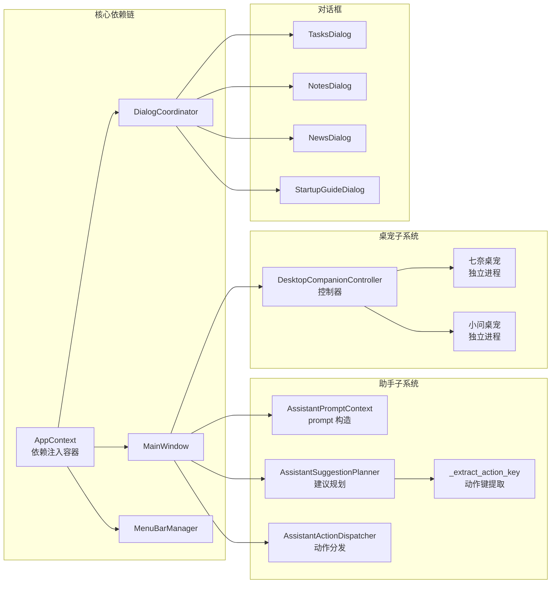
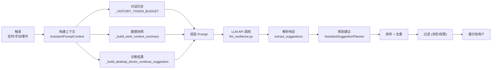
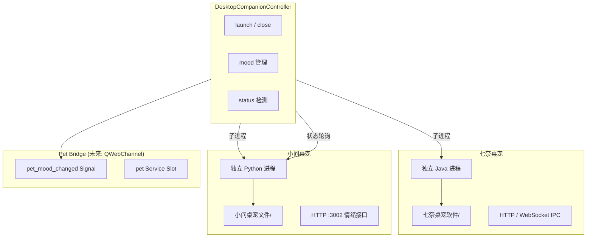
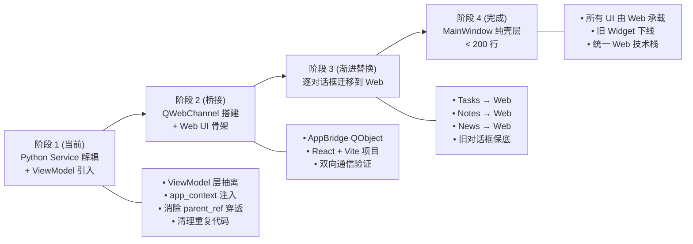
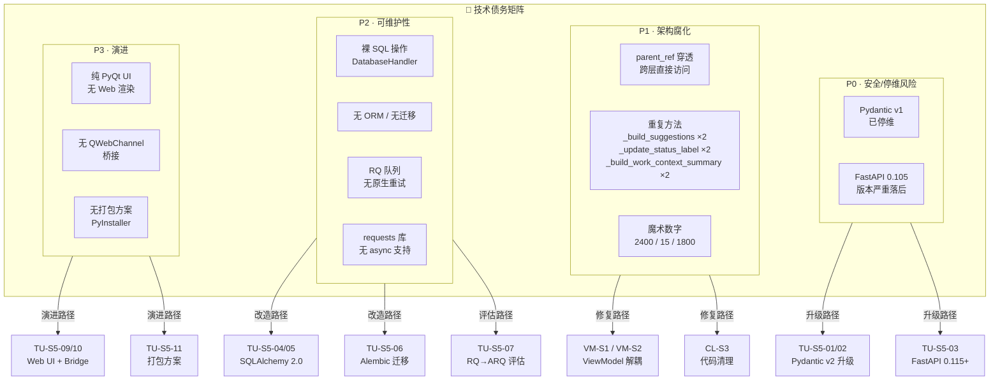

# 思忆集项目知识图谱

> 基于 Mermaid 图表的全项目知识拓扑，涵盖架构、组件、数据流和演进路线。
> 生成日期：2026-04-29

---

## 目录

1. [项目全景](#1-项目全景)
2. [桌面端架构分层](#2-桌面端架构分层)
3. [后端 automation-hub 架构](#3-后端-automation-hub-架构)
4. [数据流全景](#4-数据流全景)
5. [组件依赖图](#5-组件依赖图)
6. [对话 / 建议生成链路](#6-对话--建议生成链路)
7. [桌宠子系统](#7-桌宠子系统)
8. [Web UI 迁移路线](#8-web-ui-迁移路线)
9. [技术债务全景](#9-技术债务全景)
10. [文件拓扑 (关键文件)](#10-文件拓扑-关键文件)

---

## 1. 项目全景

---

## 2. 桌面端架构分层

```mermaid
graph TD
    subgraph Layer1["🧩 View 层 (PyQt Widgets)"]
        MW2["MainWindow"]
        Cards["工作台卡片<br/>TasksCard/NotesCard/NewsCard/..."]
        Dialogs["对话框<br/>TasksDialog / NotesDialog / NewsDialog"]
        StatusBar["状态栏<br/>StatusLabel / SyncLabel"]
        Tray["系统托盘<br/>SystemTrayIcon"]
        MenuBar["菜单栏<br/>MenuBarManager"]
    end

    subgraph Layer2["🧠 ViewModel 层 (无 Qt 依赖)"]
        WVM["WorkbenchViewModel<br/>build_card_list_state()<br/>build_status_summary()<br/>collect_sync_status()"]
        SBVM["StatusBarViewModel<br/>build_sync_summary()<br/>build_alarm_count_text()"]
    end

    subgraph Layer3["⚙️ Service 层 (业务逻辑)"]
        AS["AssistantService<br/>assistant_action_dispatcher<br/>assistant_suggestion_planner"]
        DC["DesktopCompanionController<br/>桌宠启停管理"]
        SO["SyncOrchestrator<br/>数据同步编排"]
        DO["DialogCoordinator<br/>对话框协调"]
    end

    subgraph Layer4["🗄️ Repository 层 (数据访问)"]
        TaskRepo["PersonalTaskRepository"]
        NoteRepo["PersonalNoteRepository"]
        NewsRepo["PersonalNewsRepository"]
        TransRepo["TranslationHistoryRepository"]
        VocabRepo["VocabularyRepository"]
        InboxRepo["InboxRepository"]
        SettingsRepo["SettingsRepository"]
    end

    subgraph Layer5["💾 Data 层"]
        SQLite2["SQLite 本地库"]
        Config["配置文件 / YAML"]
    end

    Layer1 -->|读取状态| Layer2
    Layer2 -->|调用逻辑| Layer3
    Layer3 -->|读写数据| Layer4
    Layer4 --> Layer5

    style Layer1 fill:#e1f5fe
    style Layer2 fill:#fff9c4
    style Layer3 fill:#c8e6c9
    style Layer4 fill:#ffccbc
    style Layer5 fill:#d1c4e9
```

---

## 3. 后端 automation-hub 架构

---

## 4. 数据流全景

---

## 5. 组件依赖图

---

## 6. 对话 / 建议生成链路

---

## 7. 桌宠子系统

---

## 8. Web UI 迁移路线

---

## 9. 技术债务全景

---

## 10. 文件拓扑（关键文件）

```mermaid
graph TB
    subgraph DesktopFiles["桌面端 思忆集app/"]
        ui_main["⭐ ui_main_window.py<br/>~3000+ 行 · 核心窗口"]
        app_ctx["app_context.py<br/>依赖注入容器"]
        wvm["workbench_viewmodel.py<br/>🆕 ViewModel"]
        sbvm["status_bar_viewmodel.py<br/>🆕 StatusBar VM"]
        constants["constants.py<br/>🆕 常量集中管理"]
        asp2["assistant_suggestion_planner.py<br/>建议规划器"]
        aad2["assistant_action_dispatcher.py<br/>动作分发"]
        apc2["assistant_prompt_context.py<br/>Prompt 构造"]
        dcc2["desktop_companion_controller.py<br/>桌宠控制器"]
        dc2_2["dialog_coordinator.py<br/>对话框协调"]
        mbm2["menu_bar_manager.py<br/>菜单栏"]
        wbc["workbench_controller.py<br/>工作台控制器"]
        bridge["🆕 desktop_web_bridge.py<br/>QWebChannel 桥接"]
    end

    subgraph DialogFiles["对话盒子文件"]
        tasks_d["ui_tasks_dialog.py"]
        notes_d["ui_notes_dialog.py"]
        news_d["ui_news_dialog.py"]
        startup_d["ui_startup_guide_dialog.py"]
    end

    subgraph BackendFiles["后端 automation-hub/"]
        api_main["api/main.py<br/>FastAPI 入口"]
        schemas["api/schemas/<br/>Pydantic 模型"]
        models["🆕 api/models/<br/>SQLAlchemy 模型"]
        db_handler["DatabaseHandler.py<br/>裸 SQL"]
        worker_py["worker/worker.py<br/>RQ Worker"]
        jobs["worker/jobs/<br/>任务定义"]
    end

    subgraph Docs["文档 docs/"]
        arch["architecture-overview.md<br/>🆕 架构概述"]
        tech["tech-stack.md<br/>🆕 技术栈"]
        bridge_spec["desktop-web-bridge-spec.md<br/>🆕 桥接规范"]
        decouple["main-window-decoupling-plan.md<br/>解耦方案"]
        task_cards["free-ai-task-cards.md<br/>任务卡片"]
    end

    subgraph Tests["测试 tests/"]
        test_aad["test_assistant_action_dispatcher.py"]
        test_asp["test_assistant_suggestion_planner.py"]
        test_dcc["test_desktop_companion_controller.py"]
        test_wvm["🆕 test_workbench_viewmodel.py"]
        test_sbvm["🆕 test_status_bar_viewmodel.py"]
    end

    ui_main --> app_ctx
    ui_main --> asp2
    ui_main --> aad2
    ui_main --> apc2
    ui_main --> dcc2
    ui_main --> dc2_2
    ui_main --> mbm2
    ui_main --> wvm
    ui_main --> sbvm
    ui_main --> constants
    dc2_2 --> tasks_d
    dc2_2 --> notes_d
    dc2_2 --> news_d
    dc2_2 --> startup_d

    style ui_main fill:#ff6b6b,color:#fff
    style bridge fill:#ffd93d,color:#333
    style wvm fill:#6bcb77,color:#fff
    style sbvm fill:#6bcb77,color:#fff
    style constants fill:#6bcb77,color:#fff
    style models fill:#ffd93d,color:#333
```

---

## 附：技术栈全景速查

| 层级 | 技术 | 版本 | 说明 |
|------|------|------|------|
| 桌面框架 | PyQt6 | latest | 含 QtWebEngine |
| 后端框架 | FastAPI | 0.105 → 0.115+ | REST API |
| 数据校验 | Pydantic | v1 → v2 | schema 定义 |
| 数据库 | SQLite | 3.x | 本地存储 |
| ORM | SQLAlchemy | 🆕 2.0 | 替代裸 SQL |
| 迁移 | Alembic | 🆕 latest | schema 版本管理 |
| 任务队列 | RQ | 当前 | 待评估 ARQ/Celery |
| HTTP 客户端 | requests → httpx | 🆕 | 桌面端调用后端 |
| Web UI | React + Vite | 🆕 18+ | 渐进替换 PyQt UI |
| 桥接 | QWebChannel | Qt 内置 | Python ↔ JS 通信 |
| LLM | OpenAI / 通义千问 / DeepSeek | API | AI 功能 |
| 打包 | PyInstaller / Nuitka | 待评估 | 分发 .exe |

---

> **维护说明**：本知识图谱应与代码同步更新。重大架构变更后，请更新对应章节。
